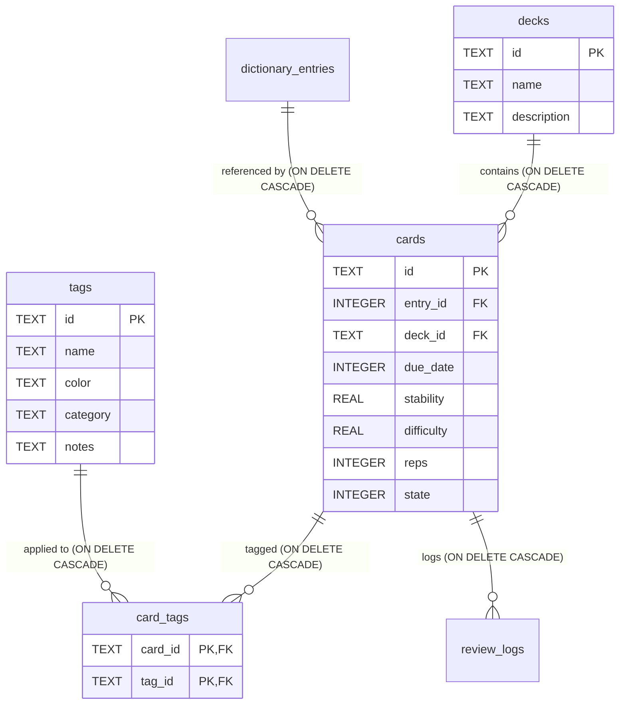

# Contexto de Arquitetura: SRS Relacional (Decks & Tags)

## 1. Esquema Relacional SQLite Atualizado
O modelo relacional do YomiFlow (`src-tauri/src/db/setup.rs`) foi expandido para suportar múltiplos baralhos (*decks*) e etiquetas (*tags*):



## 2. Políticas de Integridade e Eliminação em Cascata
1. **`cards.entry_id -> dictionary_entries(id)` (`ON DELETE CASCADE`):**
   - Caso um verbete seja limpo ou expurgado do dicionário, todos os cards e revisões derivados são removidos atomicamente.
2. **`cards.deck_id -> decks(id)` (`ON DELETE CASCADE`):**
   - Com `PRAGMA foreign_keys = ON;` ativo em todas as sessões, se um baralho customizado for excluído, todas as suas cartas e logs de revisão associados são eliminados automaticamente pelo SQLite sem necessidade de queries manuais.
3. **`card_tags` (`ON DELETE CASCADE`):**
   - Relação *many-to-many*. A remoção de um card ou de uma tag limpa imediatamente a associação correspondente na tabela de junção `card_tags`.
4. **`review_logs -> cards(id)` (`ON DELETE CASCADE`):**
   - O histórico de logs do algoritmo SRS é expurgado caso o cartão seja deletado.

## 3. Roteamento e Segmentação no Angular
- **Listagem e Gestão:** A rota `/decks` (`DeckListComponent`) apresenta a grade completa de baralhos com as contagens calculadas pelo SQLite:
  - `new_count`: Cartões com `state = 0` (Novos).
  - `due_count`: Cartões com `state > 0 AND due_date <= now` (A Revisar).
  - `total_count`: Total de cartões no baralho.
- **Roteamento de Estudo:** 
  - Ao clicar em "Estudar Baralho", o utilizador é redirecionado para `/study?deckId={id}`.
  - O `StudySessionComponent` captura o query parameter `deckId` através do `ActivatedRoute` e repassa-o ao `srsService.getDueCards(deckId)`.
  - Se nenhum `deckId` for informado, o SRS opera no modo global de revisão.
- **Inserção Direta (Manga & Vídeo):**
  - Tanto o `MangaReaderComponent` quanto o `VideoPlayerComponent` contam com um seletor `<select>` de baralho no painel lateral do *Hover Dictionary*, persistindo o novo card diretamente no baralho selecionado pelo utilizador via `add_to_srs(entryId, deckId)`.

## 4. Comandos de Validação e Testes
- **Testes Backend (Rust):**
  ```bash
  cargo test --manifest-path src-tauri/Cargo.toml commands::srs
  cargo test --manifest-path src-tauri/Cargo.toml db::setup
  ```
- **Testes Frontend (Angular):**
  ```bash
  npm test
  npm run build
  ```
