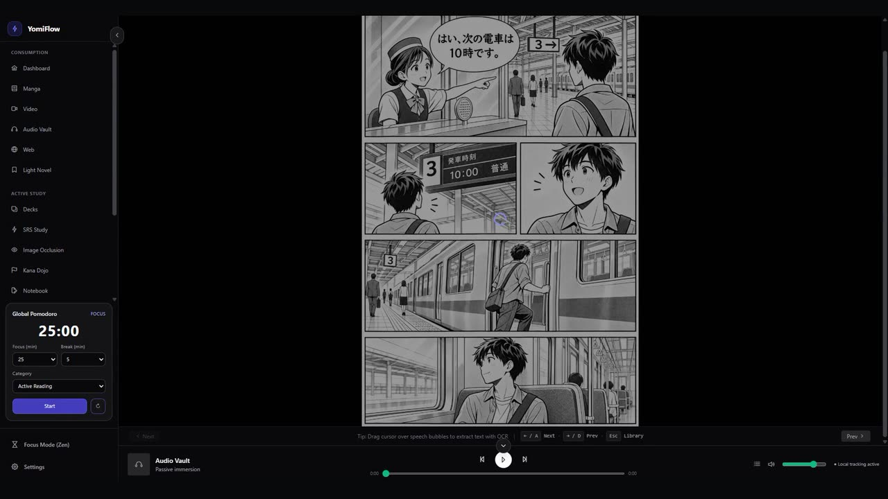
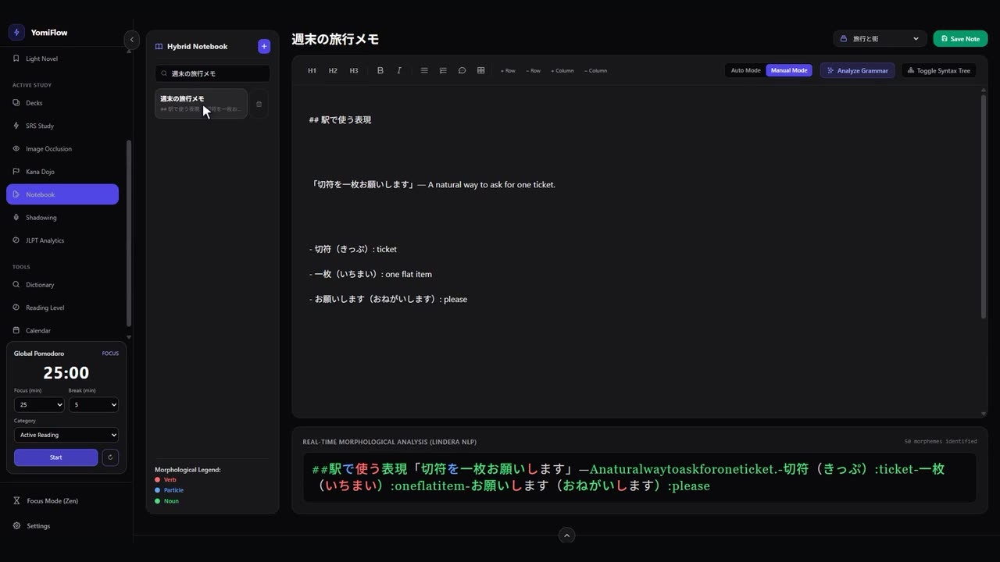
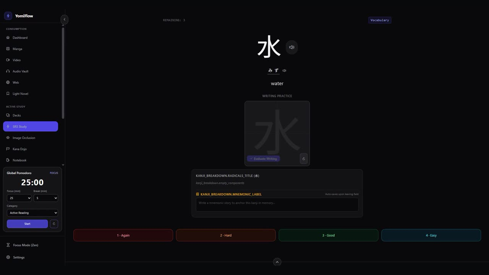

# YomiFlow

> An offline-first desktop workspace for learning Japanese through immersion.

[](https://angular.dev/)
[](https://v2.tauri.app/)
[](https://www.rust-lang.org/)
[](https://www.sqlite.org/)
[](https://github.com/ErickG123/yomiflow)

---

## Overview

**YomiFlow** brings Japanese reading, listening, note-taking, and spaced repetition together in one desktop app. Core study tools and data run locally, so you can keep studying offline. Google Drive backup is optional and user-initiated.

---

## Core Features

### Smart Media Consumption

- **Manga Reader and local OCR:** Read `.cbz`, `.zip`, `.cbr`, and `.rar` archives, and select speech bubbles for on-device text recognition with MangaOCR and ONNX Runtime (`ort`).
- **Video player and FFmpeg tools:** Play local `.mkv` and `.mp4` files, look up words in embedded subtitles, and create audio clips or screenshots for study cards.
- **NHK Web Easy Offline Reader:** Cache articles and native audio clips into local SQLite storage for distraction-free reading with integrated morphological hover breakdown.
- **Global Command Palette:** Search commands and indexed app content from the Ctrl+K palette, with translated commands and FTS5 results for cards, notes, and cached news.
- **Passive Immersion Audio Tracker & Global Player:** A persistent player continues across route changes, reads local MP3 metadata and album art, saves an audio library, and records listened milliseconds per session in SQLite.

### Relational SRS & Gamification

- **Modern Spaced Repetition (FSRS & SM-2):** Advanced memory scheduler built on pure mathematical domain models, tracking card stability and item difficulty across multiple user-defined Decks.
- **Interleaved review:** Combine vocabulary, image occlusion, grammar notes, and Kana Dojo prompts in a shared review queue.
- **Relational Integrity:** Foreign key enforcement (`PRAGMA foreign_keys = ON;`) with cascading deletions between dictionary entries, cards, custom decks, tags, and review logs.
- **Temporal Analytics & Heatmaps:** GitHub-style 16-week consistency heatmaps, review forecast projections, and JLPT coverage metrics (N5 through N1) mapped against dictionary and card corpora.
- **Achievement & Badge Engine:** Persistent milestone awards (e.g., streak milestones, kanji master badges) evaluated locally against review records.

### Global FTS5 OmniSearch

- **One Search Across YomiFlow:** Search SRS vocabulary cards, TipTap notebook notes, and cached NHK articles from the global Ctrl+K palette, with results grouped by source and matching snippets highlighted.
- **SQLite-Powered Index:** A versioned FTS5 index stays synchronized through insert, update, and delete triggers, so search remains available offline without duplicate application-side indexing logic.

### Global Pomodoro & Immersion Tracker

- **Focused Exposure Tracking:** Run global focus and break cycles from the sidebar, categorize time as active reading, passive listening, or SRS review, and receive native desktop notifications when each phase ends.
- **Persistent Immersion Metrics:** Successfully completed focus blocks are stored in local SQLite `study_sessions`, providing a durable measure of study exposure hours by category and date.

### Visual SRS (Image Occlusion)

- **SVG Mask Editor:** Upload or paste manga panels and draw multiple rectangular masks over speech bubbles, kanji, or other visual details.
- **Native Visual Recall:** Review image cards with opaque regions and reveal each hidden area on click, then schedule recall with the existing FSRS ratings while keeping images and mask coordinates local.

### Hybrid Linguistic Notebook

- **Notion-Style TipTap Rich-Text:** Clean block and markdown editor with slash command capabilities, split-screen viewing, and autosaving.
- **Real-Time Morphological NLP (Lindera):** Integrated Lindera tokenizer with IPADIC dictionary running on Rust. Parses Japanese text in real time to categorize and syntax-highlight parts of speech (verbs, particles, nouns, adjectives, and auxiliaries) with debounced IPC updates.
- **Grammar Linter and Furigana:** Offline Lindera heuristics annotate common particle errors in TipTap and offer corrections; a Ruby renderer adds readings to kanji in supported reader content.
- **Morphological Readability Analyzer (Offline MorphMan):** Analyze pasted Japanese text locally with Lindera lemmas crossed against vocabulary cards and FSRS retention in SQLite. A comprehension percentage, average retention metric, and inline unknown-word highlights help estimate how much of a passage is familiar before reading.

### Kana Dojo

- **Speed Flashcard Drill Engine:** Practice Hiragana and Katakana across Gojūon (base), Dakuon/Handakuon (ten-ten / maru), and Yōon (combination) character sets.
- **Granular Mastery Tracking:** Database persistence (`kana_mastery`) recording character-level accuracy and velocity to power global proficiency metrics on the dashboard.

### Local-First Data & Optional Integrations

- **Local study data:** Study content and history are stored on the device; no account or hosted study backend is required.
- **Optional Google Drive backup:** Back up the local SQLite database to your own Drive account when you choose.
- **Discord Rich Presence (Zen Mode):** Optional desktop status broadcast via `discord-rich-presence` displaying real-time immersion sessions and study duration.

For local development, copy `.env.example` to `.env` and set `YOMIFLOW_GOOGLE_CLIENT_ID` and `YOMIFLOW_GOOGLE_CLIENT_SECRET` to prefill the Google Drive settings. The local `.env` is ignored by Git and loaded only by debug builds. Release builds contain no built-in Google credentials; users can enter their own OAuth credentials in the Cloud Sync settings.

## Screenshots

Explore the [YomiFlow product site](https://github.com/ErickG123/yomiflow-landing) for localized feature pages and silent walkthrough clips.

| Manga reading | Japanese notebook | Spaced repetition |
| --- | --- | --- |
|  |  |  |

---

## Architecture & Technology Stack

### SQLite Schema Migrations

The Rust backend manages SQLite schema evolution through versioned migrations in `src-tauri/src/database/migrations.rs`. At startup, it creates `schema_migrations`, applies each unapplied migration in its own transaction, and records the version only after its SQL succeeds. A failed migration rolls back and stops database initialization so the app cannot continue with a partially updated schema. The checked-in `schema.sql` defines the current base schema; later migrations handle compatibility changes for existing databases.

```
+------------------------------------------------------------------------+
|                          Angular 22 Frontend                           |
|       Signals State  *  Tailwind CSS (Zinc)  *  Transloco i18n         |
|         TipTap Markdown Editor  *  Feature-Based Modular Design        |
+------------------------------------------------------------------------+
                                    |
                          Tauri v2 IPC Layer
                     (Strictly Typed Rust Commands)
                                    |
+------------------------------------------------------------------------+
|                         Rust Core Application                          |
|  * Domain-Driven Design (Pure Domain Logic vs Application Adapters)    |
|  * Asynchronous Runtime (Tokio)                                        |
|  * Heavy I/O & Compute in `tokio::task::spawn_blocking`                |
|    - Lindera NLP Tokenization                                          |
|    - ONNX Runtime MangaOCR Inference                                   |
|    - Archive & FFmpeg Media Processing                                 |
+------------------------------------------------------------------------+
                                    |
+------------------------------------------------------------------------+
|                         SQLite Storage Layer                           |
|  * `PRAGMA journal_mode = WAL` (Concurrent Read/Write Performance)     |
|  * `PRAGMA foreign_keys = ON` (Cascading Referential Integrity)        |
|  * Prepared Statements Exclusively (Parameterized SQLi Immunity)       |
+------------------------------------------------------------------------+
```

### IPC Bridge Pattern

The frontend interacts with the native runtime exclusively through typed IPC invocations using `@tauri-apps/api/core`. Computationally intensive tasks—such as morphological tokenization, OCR tensor evaluation, archive decompression, and database batch imports—are offloaded from the UI and event loop to worker threads via `tokio::task::spawn_blocking`.

---

## Project Structure

The project follows a clean separation between feature-driven UI modules, reusable components, and native Rust domain services:

```
yomiflow/
|-- .agents/                          # Architectural guidelines, context, and agent rules
|   |-- rules.md                      # Engineering standards, testing, and formatting rules
|   |-- context_gamification.md       # Temporal aggregation, streaks, and heatmap specs
|   |-- context_nlp_notebook.md       # Lindera tokenization and TipTap notebook specs
|   |-- context_srs_relational.md     # Relational SQLite SRS and cascade delete specs
|-- src/                              # Angular 22 Frontend Application
|   |-- app/
|   |   |-- core/                     # Application singletons, guards, and root services
|   |   |-- features/                 # Feature-based business modules
|   |   |   |-- calendar/             # Temporal review forecast and heatmap calendar
|   |   |   |-- dashboard/            # Proficiency analytics and quick-action hub
|   |   |   |-- decks/                # Deck management, tag assignments, and card stats
|   |   |   |-- dictionary/           # Yomichan entry search and radical breakdown
|   |   |   |-- kana/                 # Kana Dojo speed training and mastery tracking
|   |   |   |-- notebook/             # TipTap rich-text editor with Lindera NLP highlighting
|   |   |   |-- reader/               # Manga reader (.cbz), web news, and EPUB viewer
|   |   |   |-- settings/             # System preferences and Google Drive BYOS sync
|   |   |   |-- shadowing/            # Audio transcription and shadowing drill room
|   |   |   |-- srs/                  # FSRS / SM-2 flashcard study session
|   |   |   |-- stats/                # JLPT analytics and progress charts
|   |   |   |-- video/                # Video player with subtitle hover dictionary
|   |   |-- shared/                   # Generic UI components, pipes, and directives
|-- src-tauri/                        # Tauri v2 Backend & Rust Core
|   |-- src/
|   |   |-- database/                 # Versioned SQLite migrations and base schema
|   |   |-- commands/                 # Tauri IPC command entry points
|   |   |   |-- ai_ocr.rs             # ONNX Runtime MangaOCR pipeline
|   |   |   |-- dictionary.rs         # Yomichan SQLite indexed lookups
|   |   |   |-- drive_sync.rs         # OAuth2 Google Drive synchronization
|   |   |   |-- kana.rs               # Kana Dojo mastery score persistence
|   |   |   |-- news.rs               # NHK News Web Easy offline scraper and cache
|   |   |   |-- nlp.rs                # Lindera morphological analysis adapter
|   |   |   |-- reader.rs             # In-memory archive extraction and EPUB handling
|   |   |   |-- srs.rs                # FSRS calculation, deck routing, and reviews
|   |   |   |-- stats.rs              # Heatmap aggregations and JLPT coverage
|   |   |   |-- video.rs              # FFmpeg subtitle and audio extraction
|   |   |-- db/                       # Schema migrations and seed initializers
|   |   |-- domain/                   # Pure business logic (SRS math, NLP tagging, OCR)
|   |   |-- models/                   # Rust struct definitions and data transfer objects
|   |-- Cargo.toml                    # Rust dependencies and compiler configuration
|-- package.json                      # Frontend dependencies and npm build scripts
```

---

## Getting Started

### Prerequisites

Ensure the following runtimes and tools are installed on your workstation:

1. **Node.js**: v20+ with `npm`
2. **Rust & Cargo**: v1.90+ (via [rustup.rs](https://rustup.rs/))
3. **Tauri System Dependencies**:
   - **Linux**: `libwebkit2gtk-4.1-dev`, `build-essential`, `curl`, `wget`, `file`, `libssl-dev`, `libayatana-appindicator3-dev`, `librsvg2-dev`
   - **macOS**: Xcode Command Line Tools
   - **Windows**: Microsoft C++ Build Tools and WebView2 (preinstalled on Windows 10/11)
4. **FFmpeg** _(Optional, recommended)_: Required for subtitle extraction and audio clipping from `.mkv`/`.mp4` media files.

### Installation & Development

1. **Clone the Repository:**

   ```bash
   git clone https://github.com/ErickG123/yomiflow.git
   cd yomiflow
   ```

2. **Install Frontend Dependencies:**

   ```bash
   npm install
   ```

3. **Launch in Development Mode:**
   ```bash
   npm run tauri dev
   ```

## Contributing & Development Workflow

Use [Conventional Commits](https://www.conventionalcommits.org/) for every commit. Commit messages must use a recognized type and description, such as `feat: add study shortcut`, `fix: correct sidebar overflow`, or `chore: update dependencies`. Commitlint validates each message.

Husky runs local checks before commits: lint-staged formats staged Angular TypeScript, HTML, and SCSS with Prettier and applies ESLint fixes to TypeScript. The pre-commit hook also checks Rust formatting with `cargo fmt` and runs Clippy with warnings treated as errors.

## CI/CD & Release Flow

Contributors do not need to create version tags manually. Use Conventional Commits (validated locally by Husky and Commitlint), then merge or push to `main`. GitHub Actions runs the quality and test pipeline first; only a successful run on `main` calls the release workflow. Release-worthy commits trigger automatic SemVer tagging, release notes, and builds for Windows, macOS, and Linux. Commits without a release type, such as documentation-only changes, do not create a tag.

The current release matrix packages Linux on Ubuntu 24.04 and builds macOS for Apple Silicon (`aarch64`) only. Ubuntu 24.04 is needed to link the ONNX Runtime native objects used by Rust coverage and the app. Intel and universal macOS builds are currently unavailable because the configured ONNX Runtime crate has no Intel macOS prebuilt binary. The Linux job installs GTK, WebKitGTK, AppIndicator, ALSA, librsvg, and `patchelf` development dependencies required by Tauri packaging. Release jobs grant the GitHub Actions token `contents: write` to create the GitHub Release and upload assets.

The Rodio player keeps its output stream on a dedicated audio thread and routes commands over channels. This avoids moving CoreAudio stream callbacks across threads, which prevents a macOS-only `Send` compilation failure.

`fix:` produces a patch release, `feat:` produces a minor release, and a `BREAKING CHANGE:` footer produces a major release. Maintenance commits such as `chore:`, `docs:`, `refactor:`, and `test:` are included in release notes when a release is produced, without independently advancing the version.

---

## Quality Assurance & Verification

YomiFlow enforces strict quality gates across both frontend and backend codebases:

```bash
# Frontend: Run ESLint inspection
npm run lint

# Frontend: Run Unit & Component tests (Vitest)
npm run test:coverage

# Frontend: Compile Angular production bundle
npm run build

# Backend: Verify Rust formatting
cargo fmt -- --check --manifest-path src-tauri/Cargo.toml

# Backend: Run Clippy static analysis with zero warnings allowed
cargo clippy --manifest-path src-tauri/Cargo.toml -- -D warnings

# Backend: Execute Rust test suite (SQLite in-memory test coverage)
cargo test --manifest-path src-tauri/Cargo.toml
```

---

## License

Distributed under the MIT License. See `LICENSE` for more information.
