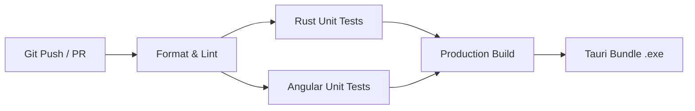

# Guia de Testes e Padrões de Qualidade (QA) - YomiFlow

Este documento define os padrões de engenharia de qualidade, arquitetura de testes automatizados e roteiros de validação manual para o projeto **YomiFlow**.

---

## 1. 🛡️ Filosofia de Testes do YomiFlow

O YomiFlow opera sob o modelo **Offline-First**, onde toda a persistência, inferência de IA, algoritmos de agendamento e reprodução de mídia acontecem localmente na máquina do utilizador. Uma falha de persistência ou regressão de cálculo compromete todo o histórico de estudo do aluno.

> **Regra de Ouro do YomiFlow:**
> *"Nenhuma funcionalidade central (SRS, Dicionário, Leitura de Mangás, Reconhecimento de Kanjis) é promovida para produção sem testes automatizados que validem o seu comportamento tanto com uma base de dados limpa (estado inicial frio) quanto com dados pré-existentes no SQLite."*

### Princípios Chave:
- **Zero Efeitos Colaterais:** Testes automatizados nunca devem gravar dados na pasta real do utilizador (`%APPDATA%/yomiflow`).
- **Isolamento de Camadas:** O Frontend Angular deve ser 100% testável em ambiente de emulação (jsdom/browser) sem exigir a execução do binário Rust, simulando chamadas IPC.
- **Determinismo Temporal:** Cálculos de intervalos de repetição espaçada (FSRS) devem ser funções puras recebendo *timestamps* determinísticos como entrada.

---

## 2. 🦀 Testes de Backend (Rust & Tauri)

O backend do YomiFlow (`src-tauri/`) combina testes unitários rápidos e testes de integração com banco de dados isolado.

### 2.1 Testes Unitários (Lógica de Domínio Pura)
Mantenha testes unitários dentro de módulos `#[cfg(test)] mod tests` junto aos arquivos de domínio correspondentes:
- **Cálculo de Intervalos SRS (`commands/srs.rs`):** A função pura `calculate_srs_step(rating, current_reps, current_state, now)` calcula os intervalos sem dependência de estado global ou de conexões de banco de dados.
- **Parsing de Metadados em Memória (`commands/reader.rs`):** A função `parse_zip_metadata_reader` recebe streams de leitura com suporte a busca (`R: Read + Seek`), permitindo testar buffers gerados em memória via `std::io::Cursor` e `zip::ZipWriter` sem tocar no sistema de arquivos.
- **Avaliação de Caligrafia (`commands/grading.rs`):** Funções geométricas puras comparando vetores de traços do usuário com os nós dos caminhos SVG do KanjiVG.

### 2.2 Testes de Integração com SQLite em Memória (`:memory:`)
Para testar queries SQL, transações atômicas e migrações sem afetar a base de dados real do usuário, utilize conexões SQLite em memória:

```rust
#[cfg(test)]
mod tests {
    use super::*;
    use rusqlite::Connection;

    #[test]
    fn test_sqlite_in_memory_initialization_and_queries() {
        // Cria uma base de dados isolada exclusivamente em memória RAM
        let conn = Connection::open_in_memory().unwrap();
        
        // Aplica o esquema completo de tabelas e pragmas de performance
        create_tables_and_seed(&conn).unwrap();

        // Valida consultas e integridade referencial
        let count: i64 = conn
            .query_row("SELECT COUNT(*) FROM dictionary_entries", [], |row| row.get(0))
            .unwrap();
        assert_eq!(count, 3);
    }
}
```

### 2.3 Comandos de Execução (Backend)
```bash
# Executar todos os testes unitários da biblioteca
cargo test --lib --manifest-path src-tauri/Cargo.toml

# Executar testes exibindo logs e saídas do stdout
cargo test --lib --manifest-path src-tauri/Cargo.toml -- --nocapture

# Executar linter estrito (zero warnings)
cargo clippy --manifest-path src-tauri/Cargo.toml -- -D warnings

# (Opcional) Gerar relatório de cobertura de código com cargo-tarpaulin
cargo tarpaulin --manifest-path src-tauri/Cargo.toml --lib --out Html
```

---

## 3. 🅰️ Testes de Frontend (Angular 22 + Vitest)

Os testes de frontend utilizam **Vitest** com emulação de DOM via **jsdom**, assegurando execução rápida e isolamento estrito.

### 3.1 Mocks das APIs do Tauri (`@tauri-apps/api`)
Nunca tente invocar o runtime real do Tauri nos testes unitários do Angular. Utilize o `vi.mock` do Vitest para interceptar as chamadas IPC:

```typescript
import { vi } from 'vitest'
import * as tauriCore from '@tauri-apps/api/core'
import * as tauriEvent from '@tauri-apps/api/event'

// Mock do despachante de comandos IPC
vi.mock('@tauri-apps/api/core', () => ({
  invoke: vi.fn(),
}))

// Mock do sistema de eventos do Tauri
vi.mock('@tauri-apps/api/event', () => ({
  listen: vi.fn(),
}))
```

Nas suítes de teste, defina o retorno esperado para cada comando:
```typescript
vi.mocked(tauriCore.invoke).mockImplementation(async (cmd: string, args?: unknown) => {
  if (cmd === 'search_dictionary') {
    return [{ id: 1, kanji: '猫', reading: 'ねこ', meaning: 'cat', in_srs: false }]
  }
  return null
})
```

### 3.2 Testes de Componentes e Signals
- **Verificação de Signals Reativos:** Assegure que os sinais como `isLoading()`, `downloadProgress()`, e `searchResults()` refletem o estado assíncrono exato antes e após a resolução de Promises.
- **Atalhos de Teclado (Hotkeys):** Simule eventos de teclado no `window` via `KeyboardEvent` e verifique:
  1. Se as teclas de navegação (`ArrowLeft`, `ArrowRight`, `a`, `d`) acionam a troca de página.
  2. Se a tecla `Escape` fecha drawers abertos sem navegar para fora da página.
  3. Se a navegação é bloqueada quando o elemento ativo no documento é um campo de texto (`input` ou `textarea`).

### 3.3 Comandos de Execução (Frontend)
```bash
# Executar suíte completa de testes unitários uma única vez
npm run test:ci

# Executar testes em modo watch durante o desenvolvimento
npm run test:watch

# Executar o linter de código (ESLint)
npm run lint

# Validar compilação do bundle de produção (AOT + Lazy Loading)
npm run build
```

---

## 4. 📋 Roteiros de Teste Manual (QA Scenarios)

Para funcionalidades multimídia e de integração com periféricos e sistema operacional, siga os roteiros manuais abaixo antes de cada release.

### 🧪 Cenário A: O Motor SRS (Repetição Espaçada)
1. **Inicialização Limpa:** Abra o YomiFlow com o banco de dados recém-inicializado.
2. **Criação de Cartão:** Vá para a aba **Dicionário**, pesquise pelo termo `食べる` e clique no botão `+` (Adicionar ao SRS).
3. **Validação na Fila:** Acesse a aba **Estudo** (`/study`). O cartão `食べる` deve estar disponível para revisão.
4. **Interação com Atalhos:**
   - Pressione `Espaço` para virar o cartão.
   - Pressione a tecla `2` para classificar como **Hard**.
5. **Avanço Temporal:** Feche o aplicativo, avance a data do sistema operacional em 1 dia e reabra o aplicativo.
6. **Critério de Sucesso:** O cartão deve reaparecer na lista de cartões pendentes de revisão com repetições (`reps`) incrementadas.

---

### 🧪 Cenário B: Leitor de Mangás e OCR
1. **Carregamento de Arquivo Pesado:** Na aba **Biblioteca** (`/manga`), clique em "Abrir Ficheiro" e selecione um arquivo `.cbz` ou `.zip` com mais de 100MB.
2. **Navegação Contínua:** Abra o leitor e navegue rapidamente pelas páginas usando as teclas `A` e `D`.
3. **Seleção de Balão (Recorte):** Clique e arraste o mouse sobre um balão de fala japonês para criar o retângulo de corte.
4. **Extração de Texto:** Solte o mouse para disparar o OCR.
5. **Critério de Sucesso:**
   - A barra lateral de dicionário deve abrir instantaneamente com o texto japonês extraído.
   - O texto deve aparecer limpo, sem caracteres parasitas de borda (ex: `|`, `_`, `~`).
   - A interface principal do leitor não deve congelar durante o processamento da imagem.

---

### 🧪 Cenário C: Kanji Pad e Áudio Nativo (TTS)
1. **Abertura do Kanji Pad:** No modo de estudo de SRS, localize um cartão que contenha um Kanji (ex: `猫`) e abra o modal de caligrafia.
2. **Áudio do Termo:** Clique no ícone de alto-falante (`pi-volume-up`) ou pressione a tecla `R`.
   - *Verificação:* O sintetizador de fala do sistema deve reproduzir o termo em japonês audível.
3. **Desenho e Avaliação:** Desenhe os traços do caractere no `<canvas>` e clique no botão **"Avaliar Escrita"**.
4. **Feedback Visual:**
   - Se os traços estiverem corretos (>80%), os traços no canvas devem ser repintados na cor **Verde** (`#10b981`).
   - Se a pontuação for média (>50%), devem ser repintados em **Amarelo** (`#eab308`).
   - Se incorretos, em **Vermelho** (`#f43f5e`).
5. **Limpeza e Retry:** Clique no botão **"Limpar"**.
   - *Verificação:* O canvas deve ser totalmente limpo, resetando o status e permitindo nova tentativa imediata.

---

### 🧪 Cenário D: Player de Vídeo e Áudio Nativo (FFmpeg)
1. **Carregamento de Vídeo:** Acesse a aba **Vídeo** (`/video`) e selecione um arquivo `.mkv` contendo faixa de legenda embutida.
2. **Hover Dictionary:** Quando uma legenda aparecer na tela, passe o cursor do mouse sobre uma palavra.
   - *Verificação:* O vídeo deve pausar imediatamente e a palavra deve ser pesquisada no dicionário da barra lateral.
3. **Corte de Áudio SRS:** Na barra lateral, clique no botão **"Áudio Nativo"** no cartão do vocabulário.
4. **Critério de Sucesso:**
   - Um arquivo `.mp3` deve ser gravado na pasta de mídias do aplicativo com o trecho exato da fala.
   - Um alerta deve confirmar a criação do cartão SRS vinculado ao clipe de áudio.

---

## 5. 🚀 Integração Contínua (CI/CD Pipeline)

Antes de aprovar qualquer Pull Request ou compilar o instalador de produção (`.exe`), os seguintes estágios de CI/CD devem ser executados e aprovados com sucesso:



### Checklist Obrigatório de CI (Pré-Commit & Push):
- [ ] **Lint do Frontend:** `npm run lint` finaliza com código 0 (sem erros de ESLint ou variáveis/atribuições não utilizadas).
- [ ] **Testes do Frontend:** `npm run test:ci` passa com 100% de sucesso em todas as suítes (Vitest).
- [ ] **Build de Produção:** `npm run build` compila todos os chunks de forma otimizada sem warnings ou erros de template.
- [ ] **Auditoria de i18n:** Todos os textos de UI usam `Transloco` e as chaves existem de forma sincronizada em `pt.json`, `en.json` e `es.json`.
- [ ] **Formatação Rust:** `cargo fmt -- --check --manifest-path src-tauri/Cargo.toml` sem divergências de estilo.
- [ ] **Linter Rust:** `cargo clippy --manifest-path src-tauri/Cargo.toml -- -D warnings` sem avisos.
- [ ] **Testes do Backend:** `cargo test --manifest-path src-tauri/Cargo.toml` passa em todos os testes unitários e de integração.
- [ ] **Checagem do Backend:** `cargo check --manifest-path src-tauri/Cargo.toml` compila sem erros.

---

## 6. 🌊 Testes da Fase 5 (Alta Imersão)

Checklists rigorosos para validar o comportamento das novas ferramentas de alta imersão:

### 🧪 Cenário D: Dicionário de Frequência
- [ ] **Ocultação de Badges em Casos Nulos:**
  - Garantir que palavras com `rank` nulo/indefinido não exibem nenhuma badge de classificação na interface (evitando badges quebradas como `Top NaN` ou placeholders vazios).
- [ ] **Escalabilidade e Não-bloqueio de IPC:**
  - Validar se o comando de importação em massa do SQLite (`import_frequency_list`) insere dezenas de milhares de registos numa única transação atômica (`BEGIN TRANSACTION`) sem bloquear o Event Loop do Tauri/Rust.
- [ ] **Distribuição de Cores e Categorias de Rank:**
  - Testar palavra com `rank <= 1500`: deve exibir badge verde `Core (Top 1.5K)`.
  - Testar palavra com `1501 <= rank <= 5000`: deve exibir badge azul `Comum (Top 5K)`.
  - Testar palavra com `rank > 5000`: deve exibir badge cinzenta `Rara`.

### 🧪 Cenário E: Renderização de Pitch Accent
- [ ] **Padrão Estático e Curvatura Visual:**
  - Injetar o padrão de pitch estático `[0, 1, 1, 0]` (ou notação textual equivalente) no Frontend via mocks no Angular.
  - Verificar se o CSS aplica a borda superior (`border-t-2 border-orange-400`) estritamente nos kanas centrais de tom alto e a barra vertical de queda (*drop*) no ponto de transição descendente.
- [ ] **Sincronização com Áudio TTS:**
  - Clicar no botão de áudio nativo integrado no `<app-pitch-accent>`.
  - Garantir que a síntese de fala reproduz o termo correspondente sem que a visualização sofra oscilações de layout (*layout shifts*).

### 🧪 Cenário F: Persistência de Mnemónicas (Auto-Save)
- [ ] **Ciclo de Auto-Save via Evento Blur:**
  - No `KanjiBreakdownComponent`, digitar uma história no `<textarea>`.
  - Disparar o evento `blur` (clicar fora do campo ou mudar o foco).
  - Recarregar a aplicação ou navegar entre telas e verificar se a invocação de `get_kanji_details` recupera o texto guardado com integridade.
- [ ] **Sanitização e Segurança (XSS Defense):**
  - Injetar payloads de script na mnemónica (ex: `<script>alert('xss')</script>` ou ``).
  - Garantir que o Angular sanitiza a saída nativamente ao renderizar os dados, prevenindo qualquer execução arbitrária de código.

### 🧪 Cenário G: Cloud Sync (Google Drive OAuth2 & Backup)
- [ ] **Abertura e Redirecionamento Local do Micro-Servidor:**
  - Na aba de Configurações, acessar **"Backup em Nuvem"** e clicar em **"Conectar com Google Drive"**.
  - O navegador web padrão do sistema deve abrir automaticamente na página de consentimento do Google (`accounts.google.com`).
  - O micro-servidor HTTP local deve escutar na porta `8080` (`http://localhost:8080/oauth/callback`) de forma não-bloqueante, sem travar a interface do Tauri.
- [ ] **Troca de Tokens e Persistência Segura:**
  - Após aprovar o acesso no navegador, a aba deve exibir a mensagem de sucesso *"Autenticação Concluída com Sucesso!"* estilizada em tema escuro.
  - O YomiFlow deve atualizar o estado para **"Conectado"** e exibir o botão **"Fazer Backup Agora"**.
- [ ] **Validação do Backup no Google Drive:**
  - Clicar em **"Fazer Backup Agora"**.
  - Um Toast verde deve confirmar a conclusão exibindo o ID do ficheiro gerado.
  - Acessar o Google Drive no navegador e verificar se o ficheiro `yomiflow_backup.db` está presente na conta, contendo o backup do banco SQLite original.

### 🧪 Cenário H: Caderno Híbrido (NLP & TipTap Editor)
- [ ] **Digitação e Análise Morfológica (Modos Auto vs Manual):**
  - Navegue para `/notebook` na barra de navegação superior.
  - **Validação de Debounce no Modo Auto:**
    - Alterne o segmented control para **"Modo Auto"**.
    - Digite uma frase rapidamente (ex: `毎日日本語を勉強します`).
    - *Critério de Sucesso:* Confirme que a chamada IPC só ocorre uma vez, após parar de digitar por 750ms (`debounceTime(750)`), evitando requisições redundantes a cada caractere digitado.
  - **Validação do Modo Manual:**
    - Alterne para o **"Modo Manual"**.
    - Digite uma nova frase (ex: `本を読みます`).
    - *Critério de Sucesso:* Verifique que as cores continuam cinzentas e nenhuma chamada morfológica é disparada enquanto digita, até clicar explicitamente no botão com ícone de faíscas **"Analisar Gramática"**.
  - **Preservação de Posição do Cursor:**
    - Digite no meio de um parágrafo e acione a análise (ou aguarde no modo auto).
    - O texto é atualizado com as cores do Tailwind (`.text-red-400`, `.text-blue-400`, `.text-green-400`) sem que o cursor pule inesperadamente para o fim do documento.
- [ ] **Teste de Resiliência com Caracteres Vazios e Pontuação:**
  - Testar envio de strings vazias, espaços repetidos e quebras de linha (`\n\n`).
  - O analisador morfológico deve retornar array vazio sem gerar panics ou travar a UI.
- [ ] **Persistência e Auto-Save no SQLite:**
  - Digite um título e um conteúdo em Markdown e clique no botão de salvar (ou aguarde auto-save).
  - Verifique na tabela SQLite `notebook_entries` que a nota foi persistida com os campos `id`, `title`, `content_md`, `created_at` e `updated_at`.
  - Recarregue a página ou selecione a nota na listagem lateral para verificar a restauração fidedigna do conteúdo Markdown.

### 🧪 Cenário I: Isolamento de Decks e Baralhos Temáticos
- [ ] **Criação de Baralhos Temáticos:**
  - Acesse a aba **Baralhos** (`/decks`) ou utilize o link no Dashboard principal.
  - Crie dois baralhos distintos:
    1. *"JLPT N3"* (ex: "Vocabulário do exame intermediário")
    2. *"Vocabulário de Animes"* (ex: "Palavras colhidas em séries")
  - Verifique se ambos aparecem na listagem com contadores zerados de cartões (`Novos: 0`, `Revisar: 0`).
- [ ] **Inserção Segmentada com Dropdown de Baralho:**
  - Abra o leitor de mangá (`/reader`) ou o reprodutor de vídeo (`/video`).
  - Ao abrir o *Hover Dictionary* para uma palavra (ex: `食べる`), selecione o baralho *"JLPT N3"* no menu suspenso *Baralho*.
  - Clique no botão de adicionar ao SRS (`+`).
  - Retorne ao Dashboard (`/dashboard`) ou à tela de Baralhos (`/decks`).
- [ ] **Garantia de Isolamento de Revisões (Sem Vazamento):**
  - O baralho *"JLPT N3"* deve exibir `Novos: 1`, enquanto o baralho *"Vocabulário de Animes"* deve permanecer estritamente com `Novos: 0`.
  - Clique em **"Estudar Baralho"** no baralho *"Vocabulário de Animes"* (`/study?deckId=...`).
  - *Critério de Sucesso:* A sessão de estudo deve informar que não há cartões pendentes para este baralho, comprovando que as revisões do *"JLPT N3"* não vazam para outros baralhos.
  - Ao iniciar os estudos no baralho *"JLPT N3"*, o cartão inserido deve surgir imediatamente para revisão.
- [ ] **Eliminação em Cascata de Baralhos:**
  - Ao excluir um baralho customizado, todas as cartas vinculadas ao baralho excluído devem ser removidas atomicamente pelo mecanismo relacional `ON DELETE CASCADE` do SQLite, sem deixar registros órfãos ou inconsistências na base.

### 🧪 Cenário J: Previsão Temporal e Gamificação de Estudos
- [ ] **Acesso à Vista de Calendário:**
  - Navegue para `/calendar` através da barra de navegação superior.
  - Verifique se o mês atual é exibido corretamente no centro dos controles (ex: *"Outubro 2026"*).
- [ ] **Validação de Previsão de Carga SRS (Dias Futuros):**
  - No banco SQLite ou inserindo cartões pelo sistema, agende revisões com intervalos calculados para datas futuras (ex: daqui a 1, 3 e 7 dias).
  - Observe as células dos dias futuros correspondentes no calendário:
    - *Critério de Sucesso:* Pequenas badges vermelhas (`bg-rose-500/20 text-rose-300`) devem surgir indicando o número exato de cartões agendados (`X cards`).
- [ ] **Avanço Manual de Data do Sistema para Testes de Ofensiva (Heatmap):**
  - Complete uma sessão de estudos em `/study` para gerar registros na tabela `review_logs`.
  - O dia atual deve exibir imediatamente a marcação verde de revisões concluídas.
  - Avance o relógio do sistema operacional em 1 dia (ou simule registros com timestamps do dia seguinte via query SQLite).
  - Recarregue o `/calendar`: o dia anterior agora deve figurar como passado com o tom de verde correspondente ao volume de revisões, enquanto o novo dia atual recebe a borda índigo de destaque.
- [ ] **Sincronização com o Caderno Híbrido:**
  - Crie uma nota em `/notebook`.
  - No `/calendar`, verifique se o dia de criação recebe o ponto indicador âmbar pulsante (`bg-amber-400`).
  - Ao clicar no dia, o painel lateral deve listar a nota com título e prévia do Markdown, contendo o botão "Abrir Caderno".

### 🧪 Cenário K: Auditoria de Segurança e DDD (Sanitização e Robustez de Domínio)
- [ ] **Prevenção de XSS no Frontend (Caderno Híbrido & Dicionário):**
  - No editor `/notebook` e em componentes com renderização de HTML dinâmico, injetar strings maliciosas com tags `<script>` e vetores de eventos (``).
  - *Critério de Sucesso:* O pipe `safeHtml` e o `DomSanitizer` (SecurityContext.HTML) devem desarmar e higienizar qualquer tag de script ou handler executável. `window.__xss` deve permanecer indefinido.
- [ ] **Mitigação de DoS por Exaustão de Payload (IPC Lindera):**
  - Tentar enviar via IPC um payload de texto com tamanho superior ao limite de segurança (`MAX_JAPANESE_TEXT_BYTES = 50.000` bytes).
  - *Critério de Sucesso:* A camada de domínio `crate::domain::nlp::segment_and_tag_japanese` rejeita a requisição retornando `Err("Payload de texto excede o limite máximo permitido...")`, impedindo travamento de CPU ou esgotamento de memória no backend.
- [ ] **Auditoria de Injeção SQL (Prepared Statements Rígidos):**
  - Verificar todas as rotas SQLite em `src-tauri/src/commands/` (`nlp.rs`, `stats.rs`, `srs.rs`, `decks.rs`).
  - *Critério de Sucesso:* Todas as queries utilizam prepared statements com parâmetros posicionais `?1`, `?2` via `rusqlite::params!`. Nenhuma consulta é montada por concatenação de strings com dados de entrada.
- [ ] **Validação Estrita de Parâmetros de Domínio Temporal:**
  - Enviar datas em formatos anômalos (ex: `"2026-13-45"`, strings com formatações inconsistentes) para os comandos de estatísticas e previsão.
  - *Critério de Sucesso:* A camada `crate::domain::stats::validate_date_ymd` intercepta e rejeita os dados antes de atingirem o banco de dados.
- [ ] **Isolamento de Domínio (DDD) e DRY:**
  - Confirmar que as lógicas puras de tokenização morfológica e formatação temporal residem em `src-tauri/src/domain/`, sendo cobertas por testes unitários sem dependência direta do runtime do Tauri.


