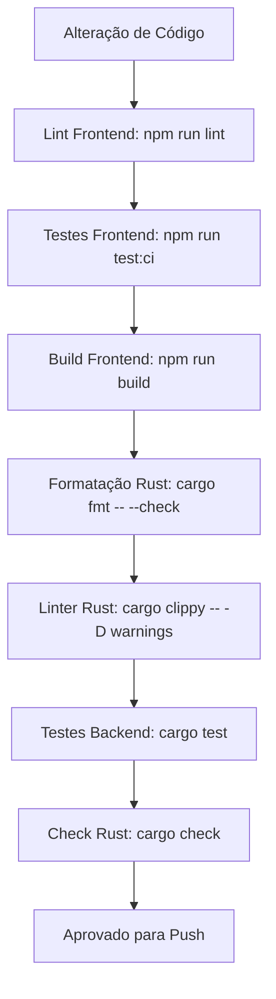

# Guia de Testes e Engenharia de Qualidade (QA) - YomiFlow

Este documento estabelece a arquitetura de testes, padrões de qualidade rigorosos e os roteiros de validação manual e automatizada para o **YomiFlow**.

---

## 1. Filosofia e Ambiente de Testes

O YomiFlow é um ecossistema **Offline-First**. Toda a ingestão de vocabulário, análise morfológica de linguagem natural, inferência neural e agendamento de repetição espaçada (SRS/FSRS) são executados localmente na máquina do utilizador.

A pirâmide de testes do YomiFlow divide-se em três camadas de garantia:

1. **Testes de Domínio & Persistência Relacional (Backend Rust):**
   - Validação de funções puras de agendamento matemático (FSRS, SM-2), tokenização do Lindera e integridade referencial em SQLite com modo WAL e chaves estrangeiras ativas (`PRAGMA foreign_keys = ON;`).
2. **Testes de Interface & Gestão de Estado (Frontend Angular):**
   - Validação de componentes reativos isolados, Angular Signals, diretivas e pipes. As chamadas nativas do Tauri (`invoke`) são estritamente interceptadas via *test doubles/mocks*, garantindo que a suíte execute em ambientes headless (Vitest / Karma / jsdom) sem depender do binário do Tauri.
3. **Testes de Aceitação e Roteiros Manuais (End-to-End):**
   - Validação holística de fluxos de ponta a ponta (onboarding, navegação, atalhos de teclado, TipTap, OCR de mídia e sincronização BYOS).

### Comandos Padrão para Execução das Suítes

```bash
# Backend: Executar a suíte completa de testes unitários e de integração
cargo test --manifest-path src-tauri/Cargo.toml

# Backend: Executar os testes exibindo mensagens do stdout
cargo test --manifest-path src-tauri/Cargo.toml -- --nocapture

# Frontend: Executar a suíte de testes unitários automatizados
npm run test:ci

# Frontend: Executar testes com monitoramento contínuo (Watch Mode)
npm run test:watch
```

---

## 2. Testes Unitários e de Integração Automatizados

### 2.1 Backend (Rust & SQLite em Memória)

Para garantir **zero efeitos colaterais** no ambiente do utilizador (evitando modificar o banco real em `%APPDATA%/yomiflow` ou `yomiflow.db`), todos os testes que envolvem banco de dados devem utilizar instâncias isoladas em memória RAM via `Connection::open_in_memory()`.

#### Padrão de Teste com SQLite `:memory:` e Cascading Deletes
```rust
#[cfg(test)]
mod tests {
    use super::*;
    use rusqlite::{params, Connection};
    use crate::db::setup::create_tables_and_seed;

    #[test]
    fn test_deck_cascade_deletion_removes_cards_atomically() {
        // Inicializa uma conexão isolada em memória
        let conn = Connection::open_in_memory().expect("Falha ao abrir SQLite em memória");

        // Cria tabelas, seeds e ativa PRAGMA foreign_keys = ON
        create_tables_and_seed(&conn).expect("Falha ao inicializar esquema do banco");

        // 1. Cria um baralho personalizado
        conn.execute(
            "INSERT INTO decks (id, name, description) VALUES (?1, ?2, ?3)",
            params!["test-deck", "Baralho de Teste", "Descrição para QA"],
        ).unwrap();

        // 2. Insere um cartão vinculado a este baralho
        conn.execute(
            "INSERT INTO cards (id, entry_id, deck_id, due_date, stability, difficulty, reps, state) 
             VALUES (?1, ?2, ?3, ?4, ?5, ?6, ?7, ?8)",
            params!["card-101", 1, "test-deck", 1700000000, 2.5, 0.3, 0, 0],
        ).unwrap();

        // 3. Deleta o baralho
        conn.execute("DELETE FROM decks WHERE id = ?1", params!["test-deck"]).unwrap();

        // 4. Valida se a deleção em cascata removeu o cartão associado
        let card_count: i64 = conn
            .query_row("SELECT COUNT(*) FROM cards WHERE id = ?1", params!["card-101"], |r| r.get(0))
            .unwrap();
        assert_eq!(card_count, 0, "O cartão deve ser removido por ON DELETE CASCADE");

        // 5. Valida violação de chave estrangeira ao tentar inserir com deck inexistente
        let invalid_insert = conn.execute(
            "INSERT INTO cards (id, entry_id, deck_id, due_date, stability, difficulty, reps, state) 
             VALUES (?1, ?2, ?3, ?4, ?5, ?6, ?7, ?8)",
            params!["card-invalid", 1, "non-existent-deck", 1700000000, 2.5, 0.3, 0, 0],
        );
        assert!(invalid_insert.is_err(), "Inserção com deck inexistente deve falhar");
    }
}
```

#### Testando Casos Extremos no Analisador Morfológico (Lindera NLP)
A biblioteca Lindera deve processar inputs arbitrários sem provocar `panic` ou estourar a memória. É mandatória a cobertura de casos limítrofes em `src-tauri/src/domain/nlp.rs`:
- **Strings Vazias e Apenas Espaços:** Devem retornar coleções vazias com `Ok(vec![])`.
- **Símbolos, Emojis e Pontuações Mistas:** Caracteres especiais (`「」：！？@#$%^&*()_+`) devem ser categorizados com POS `other` sem falhas.
- **Proteção contra Exaustão de Payload:** Payloads superiores a `MAX_JAPANESE_TEXT_BYTES` (50 KB) devem ser rejeitados imediatamente com `Err`.

---

### 2.2 Frontend (Angular & Mocks de IPC)

Nos testes do Angular (utilizando Vitest / Karma), o objeto global do Tauri e a função `invoke` do `@tauri-apps/api/core` devem ser interceptados para que nenhum comando tente acessar portas ou sockets do sistema operacional.

#### Mock Centralizado do `invoke`
```typescript
import { vi } from 'vitest'
import * as tauriCore from '@tauri-apps/api/core'

// 1. Mock do módulo core do Tauri
vi.mock('@tauri-apps/api/core', () => ({
  invoke: vi.fn(),
}))

describe('KanaService & OnboardingGuard IPC Isolation', () => {
  beforeEach(() => {
    vi.restoreAllMocks()
  })

  it('deve validar se o onboarding foi concluído interceptando has_completed_onboarding', async () => {
    // Configura o mock do invoke para responder true
    vi.mocked(tauriCore.invoke).mockImplementation(async (cmd: string) => {
      if (cmd === 'has_completed_onboarding') {
        return true
      }
      return null
    })

    const result = await tauriCore.invoke<boolean>('has_completed_onboarding')
    expect(result).toBe(true)
    expect(tauriCore.invoke).toHaveBeenCalledWith('has_completed_onboarding')
  })

  it('deve atualizar o score do kana via update_kana_score com os argumentos corretos', async () => {
    vi.mocked(tauriCore.invoke).mockResolvedValue(undefined)

    await tauriCore.invoke('update_kana_score', { character: 'あ', isCorrect: true })

    expect(tauriCore.invoke).toHaveBeenCalledWith('update_kana_score', {
      character: 'あ',
      isCorrect: true,
    })
  })
})
```

---

## 3. Cenários de Teste Manual (End-to-End)

Para validar a integridade funcional do sistema em ambiente desktop real, execute os roteiros de teste abaixo antes de qualquer release:

---

### Cenário A: Blindagem do Onboarding
**Objetivo:** Garantir que novos utilizadores passem obrigatoriamente pela tela de configuração inicial e que acessos diretos por URL sejam bloqueados até a persistência no SQLite.

1. **Estado Inicial Frio:**
   - Feche o YomiFlow e remova ou limpe a tabela `app_settings` com o comando SQLite:
     ```sql
     DELETE FROM app_settings WHERE key = 'onboarding_completed';
     ```
2. **Tentativa de Acesso Direto:**
   - Inicie a aplicação e tente navegar diretamente via URL para `/dashboard`, `/notebook` ou `/study`.
   - **Critério de Aceitação:** O `onboardingGuard` deve interceptar a rota e redirecionar imediatamente para `/onboarding`. A barra lateral de navegação e os menus superiores não devem conceder acesso antecipado às rotas internas.
3. **Conclusão do Fluxo:**
   - Na tela de Onboarding, avance os passos de boas-vindas, seleção de meta diária e preferências.
   - Clique em **"Começar a Usar"** / **"Concluir"**.
4. **Persistência no SQLite:**
   - Verifique se a aplicação redireciona automaticamente para `/dashboard`.
   - Consulte o banco SQLite:
     ```sql
     SELECT value FROM app_settings WHERE key = 'onboarding_completed';
     ```
   - O valor retornado deve ser estritamente `'true'`.
5. **Teste de Reabertura:**
   - Feche e reabra o aplicativo. A rota inicial deve ser o `/dashboard` diretamente, sem reapresentar a tela de Onboarding.

---

### Cenário B: O Caderno Híbrido (Slash Commands e NLP)
**Objetivo:** Validar a experiência de escrita no editor TipTap, o acionamento do menu flutuante por comando de barra (`/`) e a coloração morfológica em tempo real via Lindera.

1. **Acesso ao Caderno:**
   - Navegue para `/notebook` a partir da barra lateral esquerda.
2. **Ativação dos Slash Commands:**
   - No corpo do editor de texto, pressione a tecla `/`.
   - **Critério de Aceitação:** O menu flutuante deve abrir instantaneamente logo abaixo do cursor de digitação, exibindo opções como *Título 1 (H1)*, *Título 2 (H2)*, *Lista com Marcadores*, *Tabela* e *Bloco de Código*.
   - Use as setas do teclado `ArrowDown` / `ArrowUp` e pressione `Enter` para selecionar *Título 1*. O caractere `/` deve ser removido e a linha convertida em título.
3. **Análise Morfológica em Tempo Real (Modo Auto):**
   - No seletor de análise gramatical, confirme que o **Modo Auto** está selecionado.
   - Digite em japonês: `私は猫が好きです。毎日日本語を勉強します。`
   - Pare de digitar por 750 milissegundos.
   - **Critério de Aceitação:**
     - Após o tempo de debounce (`debounceTime(750)`), a análise morfológica deve ser disparada sem que o cursor do teclado pule para o final do documento.
     - O painel de morfologia ou a visualização syntax-highlighted deve colorir os elementos de acordo com o padrão Tailwind:
       - **Substantivos (`noun`):** Verde (`text-green-400 font-semibold`).
       - **Partículas (`particle`):** Azul (`text-blue-400 font-semibold`).
       - **Verbos (`verb`):** Vermelho (`text-red-400 font-semibold`).
       - **Auxiliares (`auxiliary`):** Roxo (`text-purple-400`).
4. **Sanitização de Código:**
   - Cole o trecho `<script>alert('xss')</script><b>Teste</b>` no documento.
   - Salve a nota e visualize a renderização. A tag de script deve ser desarmada sem disparar diálogos no sistema.

---

### Cenário C: Isolamento de Baralhos (Decks)
**Objetivo:** Assegurar que múltiplos baralhos gerenciam suas próprias filas de estudo sem que haja vazamento de cartões entre eles.

1. **Criação de Baralhos Separados:**
   - Navegue para a tela de **Baralhos** (`/decks`).
   - Crie dois baralhos:
     - Baralho 1: `"JLPT N4 Prep"`
     - Baralho 2: `"Vocabulário Anime"`
   - Verifique que ambos figuram com contadores zerados (`Novos: 0`, `Revisar: 0`).
2. **Adição Direcionada de Cartões:**
   - Acesse o **Dicionário** (`/dictionary`).
   - Pesquise pelo termo `約束` e adicione ao baralho `"JLPT N4 Prep"`.
   - Pesquise pelo termo `魔法` e adicione ao baralho `"Vocabulário Anime"`.
3. **Verificação de Isolamento na Sessão de Estudo:**
   - Retorne para `/decks` e clique em **"Estudar"** no baralho `"JLPT N4 Prep"` (`/study?deckId=...`).
   - Apenas o cartão `約束` deve ser apresentado para revisão. O cartão `魔法` não deve aparecer nesta fila.
   - Classifique o cartão como **Good** (tecla `3`).
   - Conclua a sessão e abra a sessão de estudos do baralho `"Vocabulário Anime"`.
   - Apenas o cartão `魔法` deve surgir para revisão.
4. **Reflexo no Calendário e Previsão:**
   - Navegue para `/calendar`.
   - Os cartões futuros agendados para revisão devem corresponder estritamente às datas calculadas sem conflitos de identificadores.

---

### Cenário D: Kana Dojo (Treinador de Velocidade)
**Objetivo:** Validar a filtragem por tipo de caractere, fluidez do quiz de Romaji e a persistência de precisão na tabela `kana_mastery`.

1. **Configuração da Sessão:**
   - Navegue para o **Kana Dojo** (`/kana`).
   - Na tela de configuração:
     - Selecione o alfabeto: **Hiragana**.
     - Ative **Gojūon (Base)** e desative **Dakuon/Handakuon** e **Yōon**.
   - Inicie o Dojo.
2. **Execução do Quiz com Foco Automático:**
   - O caractere japonês deve ser apresentado com destaque central.
   - O campo de Romaji deve receber foco automático (`autofocus`).
   - Digite a leitura correta e pressione `Enter`:
     - O container deve piscar em **Verde** e avançar rapidamente para o próximo caractere.
   - No próximo caractere, digite intencionalmente uma resposta incorreta e pressione `Enter`:
     - O container deve piscar em **Vermelho**, exibir a resposta correta e registrar o erro.
3. **Auditoria de Persistência no SQLite:**
   - Ao concluir a sessão de 10 caracteres, abra o terminal SQLite ou inspecione a tabela:
     ```sql
     SELECT character, correct_count, wrong_count, alphabet, category 
     FROM kana_mastery 
     WHERE correct_count > 0 OR wrong_count > 0;
     ```
   - **Critério de Aceitação:** Os caracteres treinados devem apresentar os respectivos incrementos em `correct_count` e `wrong_count`.
4. **Reflexo no Dashboard:**
   - Retorne para `/dashboard`.
   - A barra de proficiência global de Hiragana deve calcular o percentual de maestria baseado no saldo de acertos vs erros da tabela `kana_mastery`.

---

### Cenário E: Internacionalização Dinâmica (i18n)
**Objetivo:** Garantir que a alternância entre idiomas (Português, Inglês e Espanhol) ocorra de forma reativa, sem recarregar a janela e sem deixar textos hardcoded.

1. **Alternância de Idioma no Cabeçalho/Sidebar:**
   - No seletor de idiomas (disponível no menu ou no modal de Configurações), alterne de `PT` para `EN`.
2. **Verificação Instantânea de UI:**
   - **Critério de Aceitação:** Todos os títulos da barra lateral devem atualizar imediatamente:
     - *Consumo* -> *Consumption*
     - *Estudo Ativo* -> *Active Study*
     - *Ferramentas* -> *Tools*
   - O Dashboard deve atualizar os títulos dos cartões (*Proficiency*, *Decks*, *Daily Goal*) em tempo real, sem refresh do navegador (`window.location.reload`).
3. **Placeholders, Modais e Toasts:**
   - Abra o **Dicionário** (`/dictionary`). O placeholder de busca deve estar em inglês (*Search kanji, reading or meaning...*).
   - Abra as **Configurações** e ative o modo Zen ou salve uma anotação no Caderno:
     - As notificações Toast devem ser exibidas no idioma ativo selecionado.
4. **Ciclo Completo com Espanhol:**
   - Alterne o idioma para `ES` e confirme a consistência das chaves nos dicionários de tradução (`public/assets/i18n/es.json`).

---

### Cenário F: Immersion Tracker
**Objetivo:** Confirmar que as notificações nativas são emitidas ao terminar foco/intervalo e que um bloco de foco concluído é persistido uma única vez no SQLite.

1. Inicie o aplicativo desktop com `npm run tauri dev` e conceda permissão de notificações ao YomiFlow quando solicitado.
2. Na Sidebar, escolha duração de foco e intervalo (25/5 ou 50/10 minutos) e uma categoria, por exemplo **Leitura Ativa**. Inicie o cronômetro e minimize a janela.
3. Aguarde o término do bloco de foco. Para uma validação acelerada em desenvolvimento, altere temporariamente a duração para 1 minuto. Não pause nem reinicie o ciclo.
4. **Critério de notificação:** Deve surgir uma notificação nativa com a mensagem de foco concluído mesmo com a janela minimizada. O cronômetro deve mudar para a fase de intervalo.
5. Consulte o banco `yomiflow.db` no diretório de dados local da aplicação:
   ```sql
   SELECT category, duration_minutes, date
   FROM study_sessions
   ORDER BY date DESC
   LIMIT 1;
   ```
   **Critério de persistência:** A linha mais recente deve conter a categoria selecionada e a duração do bloco concluído, com data/hora local válida.
6. Deixe o intervalo terminar. Deve surgir uma segunda notificação nativa e o widget deve preparar o próximo bloco de foco. Confirme que o intervalo não criou outra linha em `study_sessions`.
7. Repita iniciando e pausando ou reiniciando um foco antes do término. Sessões interrompidas não devem criar linhas.

### Cenário G: Oclusão de Imagem
**Objetivo:** Validar a criação local de um cartão visual com várias máscaras e a revelação individual de cada região durante a revisão.

1. Abra **Oclusão de Imagem** na Sidebar. Faça upload de um painel de mangá em PNG, JPEG ou WebP, ou copie uma imagem e cole na janela.
2. Desenhe arrastando o ponteiro sobre um balão de fala e sobre um kanji separado. Confirme que dois retângulos numerados aparecem e que cada um pode ser removido individualmente.
3. Salve o cartão e abra a aba **Revisar**. Confirme que o painel salvo aparece com todas as regiões cobertas por retângulos opacos.
4. Clique no primeiro retângulo: apenas essa área deve revelar a imagem original; os outros retângulos devem permanecer ocultos. Clique no segundo e confirme a revelação independente. Repita a navegação com `Enter` e `Espaço` quando uma máscara estiver focada.
5. Depois de revelar todas as máscaras, classifique a recordação com **Again**, **Hard**, **Good** ou **Easy**. O cartão deve sair da lista enquanto não estiver vencido, e a avaliação deve atualizar o agendamento FSRS.
6. Reinicie o YomiFlow, reabra um cartão visual vencido na aba de revisão e confirme que a imagem e as máscaras persistem.
7. Consulte o SQLite:
   ```sql
   SELECT id, deck_id, image_path, masks_json, due_date, state, created_at
   FROM image_occlusion_cards
   ORDER BY created_at DESC
   LIMIT 1;
   ```
   Confirme que `image_path` aponta para um arquivo na pasta `image_occlusion` do diretório de dados local e que `masks_json` contém os dois retângulos com coordenadas entre 0 e 1. A avaliação deve aparecer em `image_occlusion_review_logs` para o cartão.

### Cenário H: Prática Intercalada
**Objetivo:** Confirmar que a fila reúne tipos variados e que o renderizador Angular troca a interface e limpa o estado ao avançar entre cartas diferentes.

1. Garanta que existam revisões vencidas ou novas de vocabulário em pelo menos dois baralhos, um cartão de oclusão, uma nota de gramática vinculada a um baralho com revisão vencida e kana sem prática recente.
2. Abra `/study`. A fila deve incluir cartas de todos os baralhos com revisões pendentes e os demais tipos disponíveis em uma sequência intercalada. Com pelo menos dois tipos disponíveis, tipos consecutivos devem alternar.
3. Avance por **Good** ou **Next** até observar transições entre vocabulário, oclusão, gramática e Kana Dojo. A etiqueta de tipo deve acompanhar cada UI.
4. Vire uma carta de vocabulário ou gramática, revele uma máscara de imagem e digite uma resposta parcial de kana. Avance para outro tipo a cada vez.
   **Critério de aceite:** a nova carta começa no estado inicial próprio (resposta escondida, máscaras opacas ou campo kana limpo); nenhum estado da carta anterior pode aparecer na UI seguinte.
5. Responda a cada tipo: avalie vocabulário, revele todas as máscaras e avalie a imagem, avalie a nota e responda kana. Confirme que vocabulário/imagem/notas são persistidos nos seus agendadores e kana incrementa `kana_mastery`.
6. Reabra a sessão e confirme que os itens avaliados que ainda não venceram não retornam imediatamente à fila.

### Cenário I: Analisador Lexical
**Objetivo:** Verificar a estimativa de cobertura lexical, os destaques de palavras sem cartão e a atualização do resultado após adicionar vocabulário ao SRS.

1. Abra **Nível de Leitura** na Sidebar, cole um parágrafo em japonês com palavras que já tenham cartões e pelo menos uma palavra sem cartão, e selecione **Analisar compreensão**.
2. Conte as ocorrências lexicais reconhecidas no texto. O gráfico deve apresentar `known_words / total_words × 100`, arredondado a uma casa decimal; por exemplo, 7 ocorrências com 5 presentes nos baralhos devem resultar em 71,4%.
3. Confirme que somente as ocorrências da lista `unknown_words` aparecem destacadas no texto. Repetições da mesma palavra desconhecida devem estar destacadas em cada posição.
4. Observe a métrica de retenção média SRS, que complementa a cobertura: ela considera o estágio, estabilidade e data da última revisão dos cartões conhecidos. Uma palavra com cartão novo conta como conhecida para cobertura, mesmo que sua retenção seja inicialmente 0%.
5. Adicione a palavra desconhecida a um baralho pelo dicionário, crie seu cartão e reteste o mesmo texto. O total de palavras deve permanecer igual, `known_words` deve aumentar pelas ocorrências daquela palavra e a percentagem deve subir conforme o cálculo acima; o destaque deve desaparecer dessas ocorrências.
6. Repita em EN e ES e confirme que os rótulos do analisador mudam com a localidade ativa.

## 4. Pipeline de Integração Contínua (CI/CD Quality Gates)

Antes de qualquer `git commit` e `git push`, a suíte de validação obrigatória abaixo deve ser executada sem erros:



### Checklist Rápido de Comandos Pré-Push:
```bash
npm run lint
npm run test:ci
npm run build
cargo fmt -- --check --manifest-path src-tauri/Cargo.toml
cargo clippy --manifest-path src-tauri/Cargo.toml -- -D warnings
cargo test --manifest-path src-tauri/Cargo.toml
cargo check --manifest-path src-tauri/Cargo.toml
```
# Rust Integration Tests

The Rust backend integration suite lives in `src-tauri/tests/integration_tests.rs`. It exercises the SRS service operations against the real SQLite schema and checks the Lindera bunsetsu pipeline, including JSON serialization.

Every database test opens a fresh SQLite `:memory:` connection and runs `db::create_tables_and_seed` before exercising the service. Tests never open or modify the user's `yomiflow.db` file. SRS connection-level service functions are shared with the Tauri commands so the same persistence logic is exercised without constructing a desktop runtime.

Run only this suite from the Tauri crate directory:

```bash
cd src-tauri
cargo test --test integration_tests
```

The database uses `rusqlite`, which is synchronous in this application, so these integration cases use Rust's `#[test]` harness rather than `#[tokio::test]`. Tokio is not required for the current SQLite routines.
